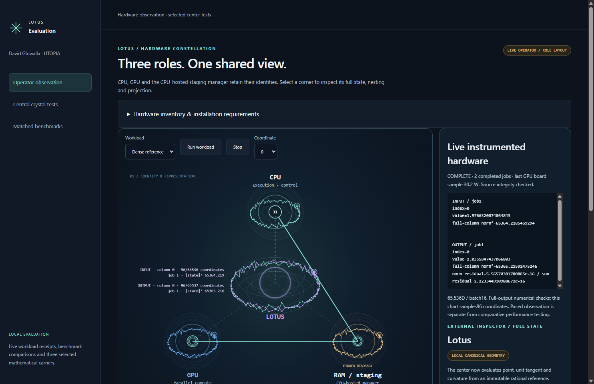
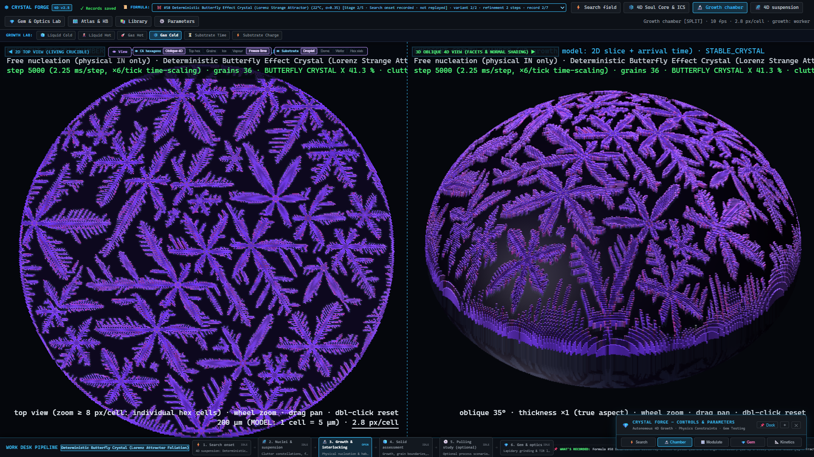

# Lotus in operation

Recorded8 November2026 from the portable evaluation rehearsal. Two real65,536D/batch16 GPU jobs completed with full-output checks. The chart plots96 selected coordinates and actual observed phase events; the screenshot is not a fresh timing or energy comparison. CPU, GPU and CPU-managed staging remain distinct around the central Lotus view.

Historical butterfly-labelled Crystal Forge development capture. It illustrates the growth process and is not a photograph of a physical crystal or of the three selected evaluation specimens. The full growth/search tool is not supplied. This capture contains no OpenGem canvas.
